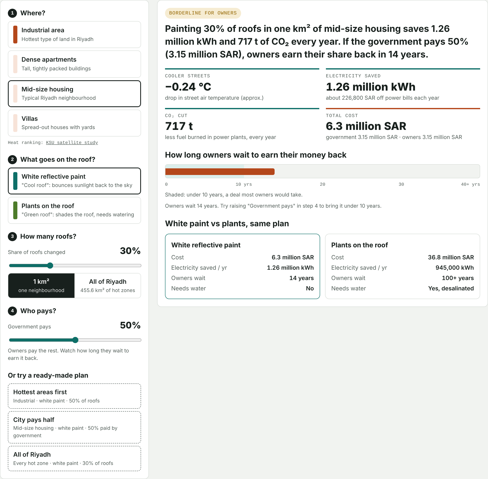

# EcoPulse Riyadh

**Paint Riyadh's roofs white, or cover them with plants? A free tool that shows what helps, what it costs, and who should pay.**

**Live demo:** https://engrazimoney.github.io/ecopulse-riyadh/
*(No sign-in, no install. It also works offline: download `index.html` and open it in any browser.)*

## The problem

- Riyadh is getting hotter. Its hottest surfaces reached **54.8 °C** in 2022, up from 51.0 °C in 2018.
- Roofs soak up the sun all day, so buildings get hot inside.
- In summer, air conditioning uses about **70%** of the electricity in Saudi homes.
- Much of that summer electricity comes from burning oil, which peaked at **0.9 million barrels a day** for power.

## The idea

Change the roofs. There are two ways:

| | White reflective paint ("cool roof") | Plants on the roof ("green roof") |
| --- | --- | --- |
| How it works | Bounces sunlight back to the sky | Plants shade the roof |
| Cooling energy saved | 10% | 7.5% |
| Needs water | No | Yes |

## What the tool does

You answer four questions:

1. **Where?** Industrial area, dense apartments, mid-size housing or villas
2. **Paint or plants?**
3. **How many roofs?** One neighbourhood, or all of Riyadh's hot zones
4. **Who pays?** How much of the cost the government covers

You get one plain sentence and a verdict. For example: *"If the government pays 50%, owners earn their share back in 14 years."* You also see the effect on street heat, electricity, CO₂, cost, and progress toward the **Saudi Green Initiative**.

The tool has built-in **Start here**, **How to use it** and **Words explained** pages, so anyone can use it.

## What I found

- **White paint beats plants in Riyadh.** It saves more electricity, costs about 6 times less, and needs no water.
- **Owners won't do it alone.** Home electricity is cheap, so owners wait about 28 years to earn their money back.
- **Government help changes everything.** If the city pays half, the wait drops to 14 years.
- **At city scale, it adds up.** White paint on 30% of roofs across Riyadh's hot zones would cut about 327,000 tonnes of CO₂ a year.

## Where the numbers come from

Every number in the tool is labelled **sourced** (from published research) or **my estimate**. Every number can be edited in the tool.

| Input | Value | Type |
| --- | --- | --- |
| Cooling energy cut: white paint / plants | 10% / 7.5% | Sourced: Elnabawi & Saber 2023 |
| Street air cooling at full conversion | 0.8 °C / 0.6 °C | Sourced: same study |
| Household electricity price | 0.18 SAR/kWh | Sourced: SEC tariff |
| Grid emissions | 0.569 kg CO₂/kWh | Sourced: Saudi Electricity Company, 2021 |
| Cooling electricity per m² of roof | 120 kWh/m²/yr | My estimate |
| Share of land covered by roofs | 25–50% | My estimate |
| Cost: white paint / plants | 60 / 350 SAR/m² | My estimate |

This is a screening tool for comparing options, not an engineering design. Results scale in a straight line from a published simulation study.

## Files

| File | What it is |
| --- | --- |
| `index.html` | The whole tool in one file |
| `docs/EcoPulse_Riyadh_Pitch.pdf` | 3-minute pitch deck |
| `docs/EcoPulse_Riyadh_Impact_and_Roadmap.pdf` | Impact snapshot and 30-60-90 day plan |

## Next steps

1. **Validate (days 1–30):** interview planners and owners, collect real electricity bills, and get contractor prices.
2. **Map and test (days 31–60):** add a satellite heat map, coat one test roof, and measure before and after.
3. **Partner (days 61–90):** share results with the Riyadh municipality and the Green Riyadh team.

## Sources

1. Imam, A. (2023). [Examining the impact of Green Riyadh Project on alleviating urban heat island effects](https://link.springer.com/doi/10.1007/s43995-023-00030-4). J. Umm Al-Qura Univ. Eng. Archit.
2. [Land use and land surface temperature in Riyadh, 1985–2015](https://isprs-archives.copernicus.org/articles/XLII-3-W2/9/2017/). ISPRS Archives, 2017.
3. Elnabawi, M. H. & Saber, E. (2023). [Cool and green roof strategies in a hot arid climate](https://research.uaeu.ac.ae/en/publications/a-numerical-study-of-cool-and-green-roof-strategies-on-indoor-ene/). J. Building Performance Simulation.
4. Alshahrani, J. & Boait, P. (2019). [Reducing high energy demand associated with air-conditioning in Saudi Arabia](https://www.mdpi.com/1996-1073/12/1/87). Energies.
5. [Saudi Electricity Company](https://www.climatescorecard.org/2023/01/saudi-electricity-company/). Climate Scorecard.
6. [Saudi Arabia uses largest amount of crude oil for power generation since 2010](https://www.eia.gov/todayinEnergy/detail.php?id=18111). US EIA, 2014.
7. [What is Saudi Green Initiative?](https://saudipedia.com/en/what-is-saudi-green-initiative) Saudipedia.
8. [Saudi Arabia electricity tariff schedule](https://rise.esmap.org/data/files/library/saudi-arabia/Renewable%20Energy/Saudi%20Arabia%20Tariff%20Schedule_2022.pdf). ESMAP RISE, 2022.

## About

Built by **Razi Moayed Money**, Industrial Engineering student at Prince Sultan University, Riyadh, for the Mawhiba MetaMinds (M3) Hackathon. Built with the aid of AI for research, coding and writing. The idea was first entered at NextStep Hacks 2026.

Code licensed under the MIT License.
